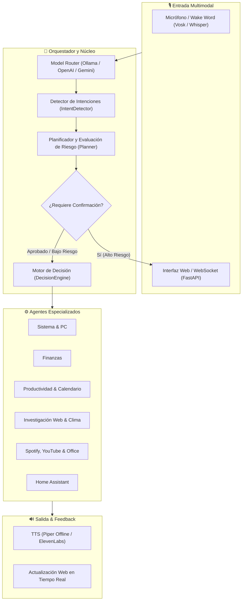

# 🧠 MindClarity

<div align="center">


<br/>

**Asistente personal de inteligencia artificial de nueva generación para Windows.**  
*Control por voz y texto, automatización de escritorio, interfaz web futurista y soporte tanto para modelos locales gratuitos (Ollama) como modelos en la nube (OpenAI GPT-4o / Gemini).*

> *"Más claridad. Más posibilidades. Un lugar para pensar en voz alta, resolver lo cotidiano y darle forma a lo que tienes en mente."*

[Características](#-características-principales) •
[Arquitectura](#-arquitectura-del-sistema) •
[Instalación](#-instalación-paso-a-paso) •
[Modos de IA](#-modos-de-inteligencia-artificial) •
[Uso](#-cómo-iniciar-mindclarity) •
[Comandos](#-ejemplos-de-comandos) •
[Estructura](#-estructura-del-proyecto)

</div>

---

## 🌟 Características Principales

- **🎙️ Voz de Extremo a Extremo de Ultra-Baja Latencia**
  - **Wake Word continua**: Activa el asistente diciendo *"YU"* o *"YU, escucha"* (mediante modelo ligero Vosk o openWakeWord ONNX).
  - **STT (Speech-to-Text)**: Transcripción rápida y precisa con **Faster Whisper** optimizado para CPU/GPU.
  - **TTS (Text-to-Speech)**: Salida de audio ultra-rápida con **Piper TTS** (100% offline y gratuita) o voces fotorrealistas con **ElevenLabs Streaming** (~300 ms).

- **🤖 Modo Híbrido: 100% Local y Privado o Nube de Alta Precisión**
  - **Modo Ollama Local (Gratis)**: Ejecuta modelos open-source como `qwen2.5:3b` o `llama3` directamente en tu máquina sin pagar suscripciones ni enviar tus datos a servidores externos.
  - **Modo Cloud Router**: Emplea **OpenAI GPT-4o** con salidas estructuradas y fallback automático a **Google Gemini** si la API principal se satura o no tiene saldo.

- **🌐 Interfaz Web Moderna & Conexión en Tiempo Real**
  - Servida por **FastAPI** con **WebSockets bidireccionales**.
  - Orbe interactivo con animaciones fluidas que reflejan el estado del asistente (*Escuchando*, *Pensando*, *Hablando*).
  - Selector de perfiles de usuario personalizables con preferencias de voz e idioma.
  - **Acceso Remoto**: Puedes abrir la interfaz desde tu móvil, tablet u otra PC en la misma red Wi-Fi (`http://IP-DE-TU-PC:8000`).

- **🖥️ Automatización Nativa de Windows**
  - Control de volumen, brillo de pantalla, capturas de pantalla instantáneas.
  - Gestión de ventanas (minimizar, maximizar, restaurar, listar).
  - Apertura y cierre inteligente de aplicaciones (Calculadora, Spotify, Navegador, etc.).
  - Gestión de archivos segura utilizando la papelera de reciclaje.

- **👥 Ecosistema Multi-Agente Especializado**
  - 📅 **Calendario**: Integración con Google Calendar para agendar y listar citas.
  - ✉️ **Correo**: Lectura y redacción de emails con Gmail.
  - 💰 **Finanzas**: Conversor de divisas, registro de gastos y balance de presupuestos.
  - 🏠 **Hogar Inteligente**: Conexión con Home Assistant para controlar luces y termostatos.
  - 🔍 **Investigación Web**: Búsqueda en DuckDuckGo, Wikipedia y clima en tiempo real.
  - 📝 **Obsidian**: Búsqueda semántica y creación de notas en tu bóveda local de Markdown.
  - 🎵 **Multimedia**: Control de Spotify y reproducción directa de canciones o videos en YouTube.
  - 💬 **Mensajería**: Soporte para notificaciones en WhatsApp, Telegram, Discord y Slack.

- **🛡️ Seguridad por Diseño y Auditoría**
  - Clasificación de riesgo en 4 niveles (*Low*, *Medium*, *High*, *Critical*).
  - Las acciones potencialmente destructivas (borrar archivos, enviar mensajes masivos) requieren **confirmación interactiva** por voz o mediante modal emergente en la web.
  - Registro de auditoría completo en la carpeta `logs/`.

---

## 📐 Arquitectura del Sistema

MindClarity opera bajo una arquitectura modular orientada a eventos desacoplados:



---

## 📋 Requisitos Previos

1. **Sistema Operativo**: Windows 10 o Windows 11 (64-bit).
2. **Python**: Versión **3.11** o **3.12** recomendada.
3. **Micrófono y Altavoces** (para el modo de interacción por voz).
4. *(Opcional para modo local)*: [Ollama para Windows](https://ollama.com/download/windows).
5. *(Opcional para modo nube)*: Claves de API de [OpenAI](https://platform.openai.com/) y/o [Google AI Studio (Gemini)](https://aistudio.google.com/).

---

## 🚀 Instalación Paso a Paso

### 1. Clonar el Repositorio

```bash
git clone https://github.com/ronnann03/MindClarity.git
cd MindClarity
```

### 2. Crear y Activar el Entorno Virtual

En PowerShell o Símbolo del Sistema:

```powershell
python -m venv .venv
.\.venv\Scripts\activate
```

### 3. Instalar Dependencias

```powershell
pip install --upgrade pip
pip install -r requirements.txt
```

> **Nota:** Para habilitar el control completo de Windows mediante COM (Office, automatización), ejecuta:
> ```powershell
> python -m pywin32_postinstall -install
> ```

### 4. Configurar Variables de Entorno

Copia el archivo de plantilla `.env.example` y renómbralo a `.env`:

```powershell
copy .env.example .env
```

Abre `.env` en tu editor favorito y ajusta tus preferencias.

---

## ⚡ Modos de Inteligencia Artificial

### Opción A: Modo 100% Local y Gratuito con Ollama (Recomendado para empezar)

No requiere tarjetas de crédito ni claves API:

1. Instala Ollama desde [ollama.com](https://ollama.com).
2. Descarga el modelo recomendado (rápido y ligero):
   ```powershell
   ollama pull qwen2.5:3b
   ```
3. En tu archivo `.env` verifica que esté configurado:
   ```dotenv
   AI_PROVIDER=ollama
   OLLAMA_BASE_URL=http://127.0.0.1:11434
   OLLAMA_MODEL=qwen2.5:3b
   TTS_PROVIDER=piper
   ```
4. ¡Listo! Todo el razonamiento y la voz correrán en tu propio equipo.

---

### Opción B: Modo Cloud / Nube (Máxima Precisión)

Utiliza modelos de lenguaje de vanguardia con respuesta ultra-rápida:

1. Configura tus credenciales en el archivo `.env`:
   ```dotenv
   AI_PROVIDER=auto
   OPENAI_API_KEY=sk-tu-clave-de-openai
   GEMINI_API_KEY=tu-clave-de-gemini
   ELEVENLABS_API_KEY=tu-clave-de-elevenlabs
   TTS_PROVIDER=auto
   ```
2. Si la API de OpenAI presenta problemas de cuota o conexión, MindClarity conmutará de manera transparente a Gemini para evitar interrupciones.

---

## 💻 Cómo Iniciar MindClarity

Puedes arrancar MindClarity de dos formas sencillas:

### Método 1: Mediante la Terminal

Con el entorno virtual activado:

```powershell
python -X utf8 main.py
```

### Método 2: Mediante los Scripts Incluidos

- Haz doble clic en **`START_YU.bat`** para iniciar automáticamente el asistente.
- O en PowerShell ejecuta **`.\START_YU_LOCAL.ps1`** para el modo Ollama supervisado.

Una vez iniciado el servidor:
- **Interfaz Web**: Abre [http://localhost:8000](http://localhost:8000) en tu navegador.
- **Documentación OpenAPI**: Explora los endpoints en [http://localhost:8000/docs](http://localhost:8000/docs).

---

## 🗣️ Ejemplos de Comandos

Puedes interactuar hablando directamente al micrófono o escribiendo en la caja de texto:

| Categoría | Ejemplo de Comando | Acción Realizada |
| :--- | :--- | :--- |
| **Conversación** | *"¿Cómo estás hoy?", "Explícame qué es la computación cuántica"* | Conversación empática y concisa |
| **Control de Sistema** | *"Sube el volumen al 80%", "Baja el brillo a la mitad", "Haz una captura de pantalla"* | Control nativo de hardware y OS |
| **Ventanas y Apps** | *"Abre la calculadora", "Minimiza Chrome", "Cierra el Bloc de notas"* | Manipulación de ventanas de Windows |
| **Archivos** | *"Crea una carpeta llamada Informes en el Escritorio"* | Operación de disco protegida por confirmación |
| **Música y Vídeo** | *"Pon música jazz en YouTube", "Reproduce mi playlist en Spotify"* | Automatización multimedia |
| **Investigación** | *"¿Quién inventó la imprenta?", "¿Qué tiempo hace hoy en Lima?"* | Consulta web rápida y síntesis de datos |
| **Productividad** | *"Recuérdame enviar el reporte a las 5", "Lista mis tareas pendientes"* | Gestión de agenda y recordatorios |
| **Calendario** | *"¿Qué eventos tengo agendados para mañana?"* | Consulta en Google Calendar |
| **Finanzas** | *"Convierte 150 dólares a soles", "Anota un gasto de 40 en combustible"* | Registro y cálculos financieros |
| **Hogar Inteligente** | *"Apaga las luces del estudio", "Ajusta el termostato a 21 grados"* | Control vía Home Assistant |
| **Notas Obsidian** | *"Busca en mis notas de Obsidian sobre Machine Learning"* | Búsqueda semántica en Markdown |

---

## 📂 Estructura del Proyecto

```text
MindClarity/
├── agents/                 # Agentes especializados (Finanzas, Calendario, Sistema, etc.)
│   ├── calendar_agent.py
│   ├── financial_agent.py
│   ├── smart_home_agent.py
│   └── system_agent.py
├── api/                    # Servidor FastAPI, endpoints REST y WebSockets
│   └── server.py
├── automation/             # Automatización nativa de Windows (Ventanas, Apps, PC)
│   ├── app_launcher.py
│   ├── file_manager.py
│   ├── pc_controller.py
│   └── window_manager.py
├── config/                 # Configuraciones centrales y constantes
│   ├── constants.py
│   ├── profiles.py
│   └── settings.py
├── core/                   # Orquestador, detección de intenciones y permisos
│   ├── decision_engine.py
│   ├── intent_detector.py
│   ├── orchestrator.py
│   └── planner.py
├── database/               # Repositorios y esquemas SQL (Supabase / local)
├── integrations/           # Clientes para Spotify, Discord, Telegram, Office, etc.
├── memory/                 # Gestor de memoria contextual y embeddings
├── models/                 # Conectores para Ollama, OpenAI y Gemini
├── tests/                  # Suite de pruebas automatizadas con pytest
├── ui_web/                 # Interfaz gráfica moderna (HTML5, CSS3, Vanilla JS)
│   ├── app.js
│   ├── index.html
│   └── styles.css
├── voice/                  # Pipeline de audio (Wake word, Whisper STT, Piper/ElevenLabs TTS)
│   ├── audio_capture.py
│   ├── speech_to_text.py
│   ├── text_to_speech.py
│   └── voice_pipeline.py
├── .env.example            # Plantilla limpia de variables de entorno
├── .gitignore              # Protección de secretos y archivos temporales
├── main.py                 # Punto de entrada principal
├── requirements.txt        # Dependencias de Python
└── START_YU.bat            # Lanzador rápido para Windows
```

---

## 🧪 Pruebas Unitarias

MindClarity incluye una suite de pruebas para asegurar la estabilidad del planificador, la detección de intenciones y los módulos de automatización:

```powershell
pip install pytest pytest-asyncio pytest-mock
pytest
```

---

## 🔒 Privacidad y Seguridad

- **Protección contra fugas**: El archivo `.gitignore` está configurado para evitar la subida de claves API, entornos virtuales o registros de actividad personal a repositorios públicos.
- **Acciones Protegidas**: Las operaciones con nivel de riesgo `HIGH` o `CRITICAL` (como borrar carpetas o ejecutar scripts del sistema) nunca se realizan sin la confirmación explícita del usuario.
- **Operaciones Destructivas Seguras**: Las eliminaciones de archivos se envían a la papelera de reciclaje mediante la biblioteca `send2trash`.

---

## 📄 Licencia

Este proyecto se distribuye bajo la licencia **MIT**. Consulta el archivo `LICENSE` para más información.

---

<div align="center">
Desarrollado con ❤️ por Ronaldinho Villanueva para simplificar la productividad diaria y dar vida a un asistente inteligente verdaderamente útil.
</div>
